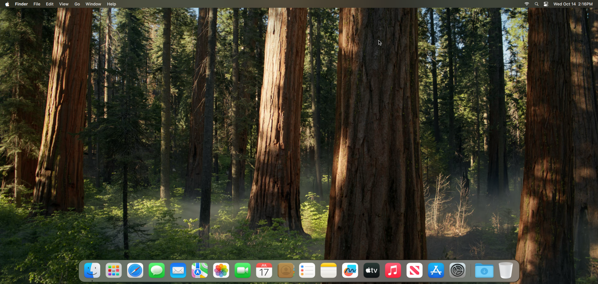
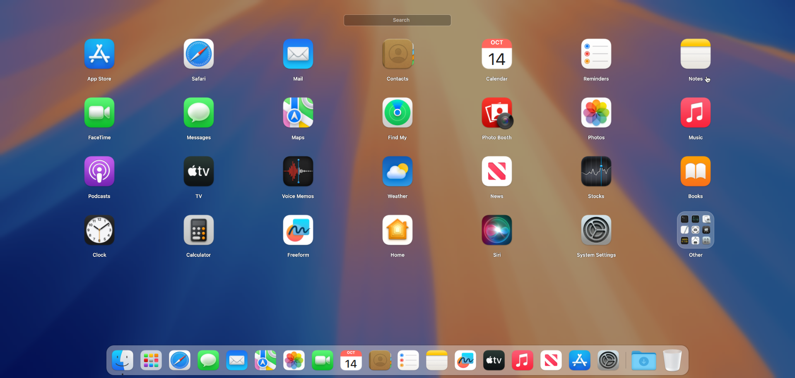

<h1 align="center">SwiftDE</h1>

<p align="center">
  <b>A pixel-perfect, native macOS Sequoia desktop environment for Linux & Wayland.</b><br>
  Built with Wayfire, LayerShellQt, Qt 6 QML, and C++17.
</p>

<p align="center">
  
  
  
  
  
</p>

---

## 📸 Screenshots

### macOS Sequoia Desktop Experience


### Launchpad with Interactive Folders & Drag-and-Drop


---

## ✨ Features

### 🖥️ macOS Sequoia Floating Pill Dock
- **Continuous Cosine Magnification**: Smooth, fluid icon expansion across 5 items with authentic physics and zero stutter.
- **Dynamic Live Calendar**: Automatically updates and displays the current date and month (e.g. `OCT 14`) in real time.
- **Running App Indicators**: Subtly glowing pill dots underneath open applications.
- **Trash & Stacks**: Dynamic empty/full Trash can and interactive Downloads folder stack.
- **Customizable & Interactive**: Drag-to-remove unpinning, right-click context menus with "Options", "Keep in Dock", and position toggles.
- **Wayland Native**: Operates via `LayerShellQt` overlay layer for perfect z-ordering above full-screen apps and Launchpad.

### 🚀 1:1 Fullscreen Launchpad
- **Frosted Acrylic Glass**: High-performance multi-pass background wallpaper blur tinted with ambient desktop colors.
- **Authentic 4x7 Sequoia Grid**: Pixel-measured proportions, Apple SF Pro typography, and icon spacing.
- **Interactive Folders**: Frosted squircles with live 3x3 mini grid previews (such as the default "Other" utility bundle).
- **Drag-and-Drop Suite**:
  - Drag an icon over another icon to instantly generate a new folder.
  - Drag items into or out of folders with animated transitions.
  - Reorder apps freely across grid slots.
  - Click-to-open folder overlay with inline editable folder titles.
- **Instant Search**: Real-time fuzzy filtering of applications and utilities.
- **Persistent Layout**: Grid configurations and custom folders are saved to `~/SwiftDE/Library/Preferences/launchpad.json`.

### 🍎 Menu Bar & Control Center
- **Native Apple Menu**: Functional *About This Mac*, *System Settings...*, *Force Quit...*, *Sleep*, *Restart...*, *Shut Down...*, and *Lock Screen*.
- **Integrated Control Center**: Quick toggles for Wi-Fi, Bluetooth, AirDrop, and Stage Manager, plus continuous sliders for display brightness and audio volume.
- **Status Tray & Spotlight**: Live clock, calendar popover, system tray indicators, and Spotlight search trigger.

### 🔒 Lock Screen & Authentication
- **macOS Sequoia Lock Screen**: High-resolution clock, date formatting, user avatar, and secure PAM authentication backend (`checkpw`).
- **Sleep & Session Management**: Seamless integration with systemd and Wayland session lock.

### ⚙️ System Settings & About This Mac
- Authentic macOS System Settings with categorized sidebar, smooth navigation, and system specification summaries.

### 🎨 Typography & Cursors
- Native bundling of **SF Pro Display**, **SF Pro Text**, and **SF Symbols 6**.
- Full high-DPI **SwiftDE macOS Sequoia cursor theme**.

---

## 🏗️ Architecture

```
┌────────────────────────────────────────────────────────┐
│                   Wayfire Compositor                   │  ← Wayland Compositor (wlroots)
│  (Cubic-bezier zoom animations, kawase blur, tiling)   │
├────────────────────────────────────────────────────────┤
│                     LayerShellQt                       │  ← Wayland Layer Shell Integration
├────────────────────────────────────────────────────────┤
│               SwiftDE Core Services (QML)              │
│  ┌──────────────┐  ┌──────────────┐  ┌──────────────┐  │
│  │  Topbar.app  │  │   Dock.app   │  │Launchpad.app │  │
│  └──────────────┘  └──────────────┘  └──────────────┘  │
│  ┌──────────────┐  ┌──────────────┐  ┌──────────────┐  │
│  │Lockscreen.app│  │AboutThisMac  │  │SystemSettings│  │
│  └──────────────┘  └──────────────┘  └──────────────┘  │
├────────────────────────────────────────────────────────┤
│           ProcessRunner / C++ Backend (Qt 6)           │  ← PAM, DBus, Brightness, Sound
└────────────────────────────────────────────────────────┘
```

---

## ⌨️ Default Keyboard Shortcuts

| Shortcut | Action |
|:---|:---|
| <kbd>F4</kbd> | Toggle Launchpad |
| <kbd>Ctrl</kbd> + <kbd>Super</kbd> + <kbd>Q</kbd> | Lock Screen |
| <kbd>Super</kbd> + <kbd>Enter</kbd> | Launch Terminal |
| <kbd>Super</kbd> + <kbd>↑</kbd> | Mission Control (Expo) |
| <kbd>Super</kbd> + <kbd>↓</kbd> | Application Windows (Scale) |
| <kbd>Alt</kbd> + <kbd>Tab</kbd> | Fast App Switcher |
| <kbd>Super</kbd> + <kbd>Q</kbd> | Close Active Window |

---

## 🛠️ Building & Installation

### Requirements
- **OS**: Linux with Wayland
- **Compositor**: Wayfire (`>= 0.8.0`)
- **Qt 6**: `qt6-base-dev`, `qt6-declarative-dev`, `qml6-module-qtquick*`, `qml6-module-qt5compat-graphicaleffects`
- **Wayland**: `layer-shell-qt-dev` / `liblayershellqt-dev`, `wayland-protocols`
- **Compiler**: GCC 11+ or Clang 13+ (C++17)
- **PAM**: `libpam0g-dev`

### Compilation

```bash
# Clone repository
git clone https://github.com/iclou4/SwiftDE.git
cd SwiftDE

# Build the SwiftDE-RunQML runner
cd System/Library/CoreServices/Lockscreen.app/Contents/MacOS
g++ -O3 -std=c++17 runner.cpp processrunner.cpp moc_processrunner.cpp \
    $(pkg-config --cflags --libs Qt6Quick Qt6Widgets LayerShellQtInterface) \
    -o /home/$USER/SwiftDE/SwiftDE-RunQML

# Build PAM authentication helper
gcc -O2 checkpw.c -lpam -o swiftde-checkpw
chmod u+s swiftde-checkpw
```

### Launching SwiftDE

Select **SwiftDE** from your display manager (GDM/SDDM) or start manually:

```bash
/usr/local/bin/swiftde-session
```

---

## 📜 Credits & License

- **Design**: Inspired by Apple's Human Interface Guidelines and macOS Sequoia.
- **Compositor**: Wayfire team & wlroots contributors.
- **License**: [GPL-3.0](LICENSE) © 2026 SwiftDE Contributors.
